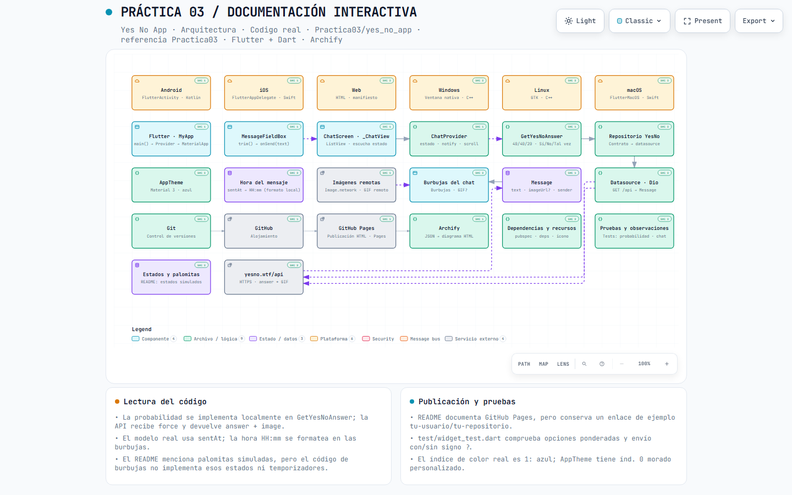

# flutter_yes_no_app_230318

A new Flutter project.

## Getting Started

This project is a starting point for a Flutter application.

A few resources to get you started if this is your first Flutter project:

- [Learn Flutter](https://docs.flutter.dev/get-started/learn-flutter)
- [Write your first Flutter app](https://docs.flutter.dev/get-started/codelab)
- [Flutter learning resources](https://docs.flutter.dev/reference/learning-resources)

---

## Funcionalidades

- **Mensajes en tiempo real:** Permite redactar y visualizar mensajes con formato claro y la hora de envío registrada.
- **Respuestas automáticas:** Al detectar un signo de interrogación (`?`) al final del mensaje, la aplicación genera automáticamente una respuesta basada en la distribución 40/40/20.
- **Integración con API:** Consulta `yesno.wtf` para descargar y renderizar un GIF acorde a la respuesta. Si la imagen no logra cargarse, se mantiene la respuesta en formato de texto.
- **Indicadores de estado (Simulación):** Muestra palomitas de *enviado*, *entregado* y *visto* simuladas dentro de la lógica interna de la aplicación.

---

## Evidencias

*A continuación se presentan las capturas de pantalla de la aplicación en funcionamiento:*

### Ícono personalizado al iniciar

### Chat y hora de envío

### Respuesta "Sí" con GIF

### Respuesta "No" con GIF

### Respuesta "Tal vez" con GIF

---

## Tecnologías utilizadas

| Tecnología | Función en la práctica |
| :--- | :--- |
| **Flutter** | Construcción de la aplicación multiplataforma. |
| **Dart** | Lenguaje de programación principal de la app. |
| **Provider / State Management** | Gestión del estado y manejo de la lista de mensajes. |
| **HTTP (Package)** | Peticiones HTTP para consumir la API externa. |
| **YesNo API (`yesno.wtf`)** | Servicio que proporciona los GIFs animados según la respuesta. |
| **Mermaid / HTML / CSS** | Generación de la arquitectura interactiva. |
| **GitHub Pages** | Publicación y hosting del diagrama de arquitectura HTML. |

---

## Arquitectura interactiva

Puedes explorar la arquitectura y el flujo de componentes de la **Práctica 03** publicada en GitHub Pages:

[Abrir el diagrama interactivo en GitHub Pages](https://jonathan2536.github.io/Practicas_DMI_230318/Practica3/flutter_yes_no_app_230318/Arquitectura/arquitectura-yes-no-app.html)

El diagrama explica detalladamente el flujo del chat, la jerarquía de widgets/componentes y el soporte multi-plataforma (Android, iOS, Web, Windows, Linux y macOS). Al hacer clic en un bloque, podrás consultar su descripción y acceder directamente al archivo fuente correspondiente en este repositorio.

