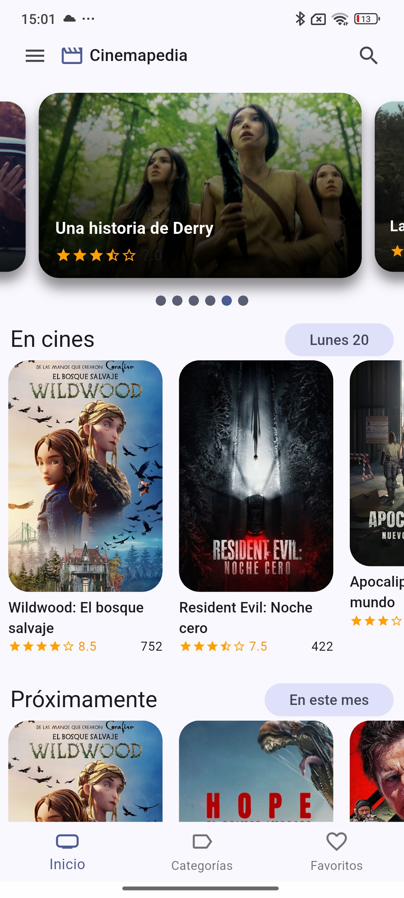
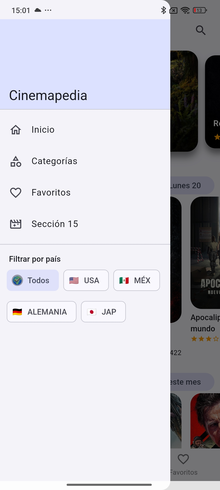
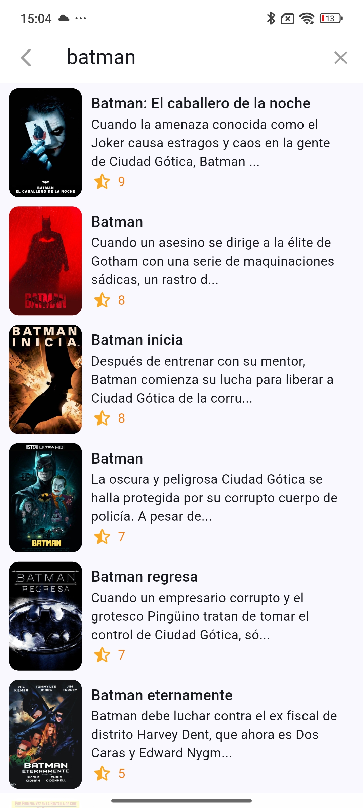
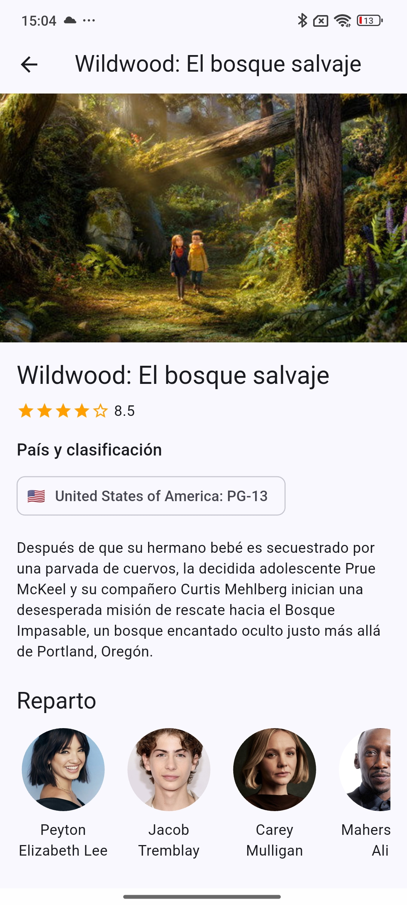
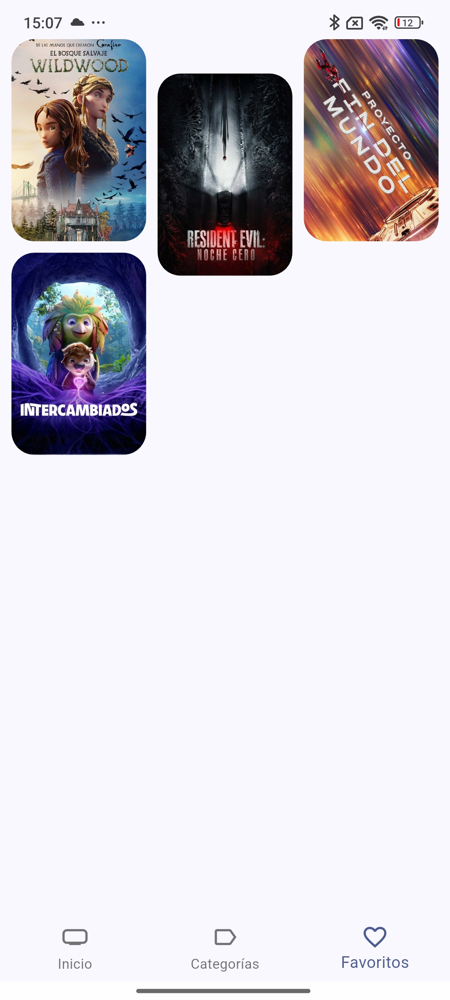
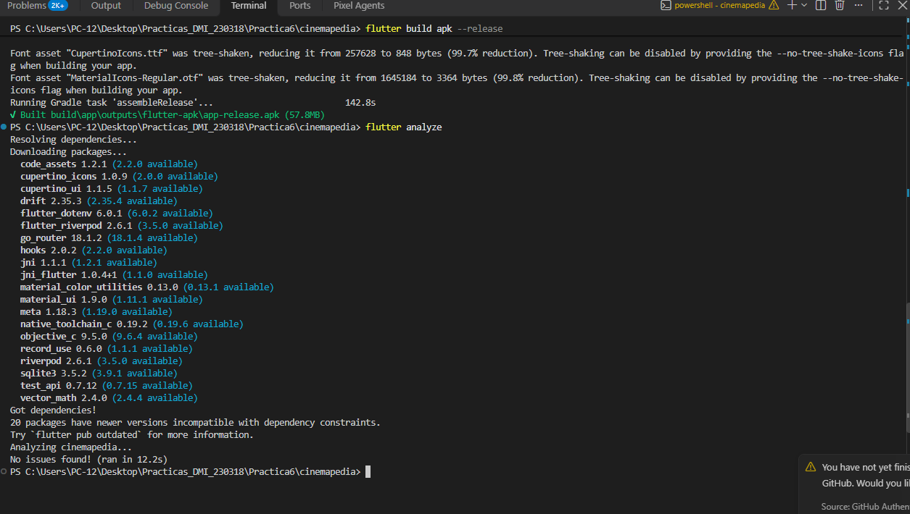
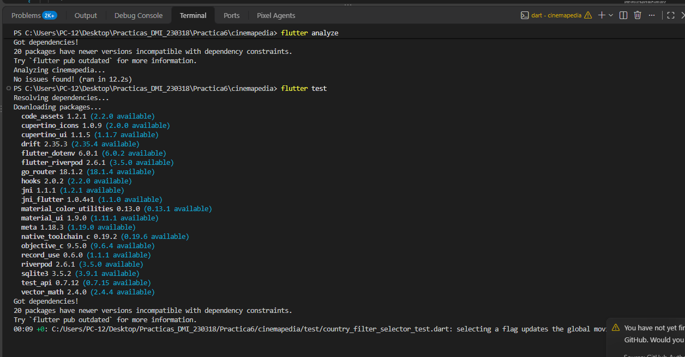

# 1. Cinemapedia

Cinemapedia es una aplicación Flutter para descubrir películas y consultar
información de TMDB. La práctica integra navegación, consumo de una API,
estado con Riverpod y persistencia local de películas favoritas.

## 2. Funcionalidades

- Catálogo de películas en cartelera, populares, mejor calificadas y próximas.
- Carrusel principal con títulos en español, calificaciones con estrellas y
  acceso al detalle de cada película.
- Búsqueda de películas y consulta de detalles, sinopsis, reparto y
  clasificaciones disponibles por país.
- Favoritos persistidos localmente con Drift.
- Filtro global del catálogo por Estados Unidos, México, Alemania y Japón, o
  vista sin filtro de país.
- Menú lateral con acceso a Inicio, Categorías, Favoritos y Sección 15.
- Desplazamiento horizontal paginado en las listas; toque para abrir el detalle,
  pulsación larga para alternar favoritos y botón para volver al inicio.
- Manejo de errores de carga, opción para reintentar y límites de tiempo para
  las solicitudes de películas.
- Ícono personalizado para la aplicación.

La pantalla Categorías y la Sección 15 son actualmente vistas placeholder; no
representan funcionalidades de catálogo independientes.

## 3. Arquitectura

La aplicación sigue una arquitectura por capas. Las vistas y widgets consumen
estado de Riverpod; los providers delegan las operaciones a repositorios de
dominio. Los repositorios conectan las interfaces del dominio con los
DataSources de TMDB y Drift. Los modelos de respuesta de TMDB se convierten a
entidades de dominio mediante mappers.

```text
Presentación (Flutter + Riverpod + GoRouter)
        ↓
Dominio (entidades, DataSources y repositorios abstractos)
        ↓
Infraestructura (repositorios, mappers, TMDB y Drift)
```

El catálogo, la búsqueda, los detalles y el reparto usan TMDB. Drift almacena
localmente los favoritos, que se pueden consultar sin volver a descargarlos.
Las solicitudes de catálogo tienen un timeout de conexión y un timeout de
recepción; el estado de cada lista informa si está cargando o si ocurrió un
error.

## 4. Tecnologías y ejecución

El proyecto utiliza **Flutter y Dart**, Riverpod para el estado, GoRouter para
la navegación, Dio para las solicitudes HTTP, `flutter_dotenv` para cargar la
configuración de TMDB, e Drift/SQLite para los favoritos. Se requiere conexión
a Internet para consultar el catálogo, las búsquedas, los detalles, el reparto
y las imágenes remotas.

### Configuración de la API

La aplicación necesita una API key de TMDB para cargar el contenido. Obtén una
clave de API v3 en [The Movie Database](https://www.themoviedb.org/settings/api)
y crea un archivo `.env` en esta carpeta (`Practica6/cinemapedia`) con:

```env
THE_MOVIEDB_KEY=tu_api_key_v3_de_tmdb
```

El archivo `.env` está declarado como asset de Flutter y se carga al iniciar la
aplicación. Si falta la variable o está vacía, la inicialización de la
configuración falla y las solicitudes no pueden autenticarse. No publiques tu
clave en repositorios ni la compartas: una clave empaquetada como asset puede
extraerse del APK o de otros builds. Para una aplicación distribuida, considera
proteger las credenciales mediante un servicio backend.

### Comandos

Ejecuta los comandos desde la carpeta `Practica6/cinemapedia`:

```text
flutter pub get
flutter analyze
flutter test
flutter run
flutter build apk --release
flutter build web
```

La ruta esperada del APK de release es
`build/app/outputs/flutter-apk/app-release.apk`; confirma que el archivo se haya
generado después de compilar. La versión declarada en `pubspec.yaml` es
`1.0.0+1`.

## 5. Publicación y prueba en línea

No hay un enlace de publicación en Appetize documentado todavía. Cuando se
publique un build, agrega aquí el enlace:

<!-- Pendiente: agregar enlace público de Cinemapedia en Appetize. -->

## 6. Evidencias de la aplicación

Capturas de la aplicación ubicadas en `lib/Assets/`.

### Interfaz y funcionalidades

<table>
  <tr>++++
    <td align="center">
      Inicio y carrusel<br>
      
    </td>
    <td align="center">
      Menú y filtro por país<br>
      
    </td>
    <td align="center">
      Búsqueda<br>
      
    </td>
  </tr>
  <tr>
    <td align="center">
      Detalle, estrellas y clasificación<br>
      
    </td>
    <td align="center">
      Favoritos<br>
      
    </td>
  </tr>
</table>

### Validación y publicación

<table>
  <tr>
    <td align="center">
      Resultados de <code>flutter analyze</code> y <code>flutter test</code><br>
      
      
    </td>
    <td align="center">
      Publicación o enlace de Appetize<br>
      <em>Pendiente de enlace</em>
    </td>
  </tr>
</table>

## 7. Conclusión

Cinemapedia combina un catálogo consultado desde TMDB, búsqueda y detalle de
películas, filtro por país, navegación con GoRouter y favoritos locales con
Drift. La disponibilidad del catálogo depende de una API key válida y de la
conexión a Internet. La ejecución real en dispositivos, la publicación en
Appetize y las evidencias visuales deben verificarse y agregarse por separado;
el análisis estático, las pruebas y las compilaciones por sí solos no
comprueban esos aspectos.
