# 1. TokTik — Práctica 04

TokTik es una aplicación Flutter para explorar videos en formato vertical. El
objetivo de la práctica es integrar navegación entre feeds, reproducción de
video, estado con Provider, persistencia local y personalización estacional.

## 2. Funcionalidades

- Secciones **Discover**, **For You** y **Favorites**.
- Navegación horizontal entre secciones y desplazamiento vertical de videos.
- Reproducción adaptada a la fuente de video.
- Likes y favoritos con persistencia local.
- Control de sonido y descripciones expandibles.
- Temas **Normal**, **Halloween**, **Christmas** y **Valentine's Day**.
- Selección automática según la fecha del dispositivo y selección manual
  persistida.
- Los temas se reflejan en el splash/logo y los sonidos estacionales; no cambian
  qué fuentes de video consulta el repositorio.
- Fuentes registradas actualmente: Local (metadatos en Dart y videos alojados
  en Google Drive), YouTube, Pixabay y Vimeo (opcional si se configuran URLs).
  Instagram existe como placeholder, pero no está conectada como fuente activa.
- El repositorio consulta las fuentes concurrentemente, intercala resultados,
  elimina IDs duplicados y conserva los resultados de fuentes que sí cargaron.

## 3. Arquitectura

La presentación consume el estado de `DiscoverProvider`. Este consulta el
repositorio, que coordina los DataSources y entrega videos en el modelo común
`VideoPost`. Los likes, favoritos y la selección de temporada se guardan
localmente mediante `SharedPreferences`. El diagrama de fuentes muestra también
que los metadatos Local usan URLs remotas, no archivos guardados en el teléfono.

**Provider local y persistencia**


[Ver diagrama interactivo de arquitectura local en GitHub Pages](https://jonathan2536.github.io/Practicas_DMI_230318/practica4/Diagrama%20de%20arquitectura%20local/architecture.html)

**Provider, repositorio y DataSources**


[Ver diagrama interactivo en GitHub Pages](https://jonathan2536.github.io/Practicas_DMI_230318/practica4/Diagrama%20con%20Repository%20y%20DataSources/architecture.html)

## 4. Tecnologías y ejecución

El proyecto utiliza **Flutter y Dart**, Provider, `video_player`,
`youtube_player_iframe`, `webview_flutter`, `shared_preferences`,
`flutter_dotenv` y `http`. La reproducción usa el reproductor de YouTube IFrame,
un WebView para Vimeo y `video_player` para URLs directas. YouTube, Pixabay,
Vimeo y Google Drive requieren conexión a Internet.

Desde la carpeta `practica4`, ejecuta:

```text
flutter pub get
flutter analyze
flutter test
flutter build apk --release
```

La ruta esperada del APK es
`build/app/outputs/flutter-apk/app-release.apk`; debe confirmarse después de
compilar. La versión declarada en `pubspec.yaml` es `1.0.0+1`.

Para servicios externos, configura localmente las variables `YOUTUBE_API_KEY`,
`YOUTUBE_PLAYLIST_ID` y `PIXABAY_API_KEY`;
Como asset de Flutter y sus valores pueden extraerse de la APK, aunque esté
ignorado por Git. Por ello, las claves embebidas no deben considerarse secretas.

La última validación documentada del proyecto (17-oct-2026) reportó
`flutter analyze` sin incidencias y 80 pruebas aprobadas con `flutter test`.
Estos resultados no verifican por sí solos la reproducción en un dispositivo.

## 5. Publicación en Appetize

Compila el APK release, súbelo a Appetize.io y pruébalo en dos configuraciones
de dispositivo virtual. Añade aquí el enlace permanente real cuando la
publicación y su ejecución se hayan comprobado.

**Enlace de la aplicación:** PENDIENTE DE AGREGAR EL ENLACE REAL DE APPETIZE.

## 6. Evidencias de la aplicación

Agrega las capturas reales bajo `docs/evidencias/`. Las rutas indicadas están
pendientes: no se crean ni se enlazan imágenes que todavía no existen.

### Interfaz y funcionalidades

<table>
  <tr>
    <td align="center">Pantalla inicial<br>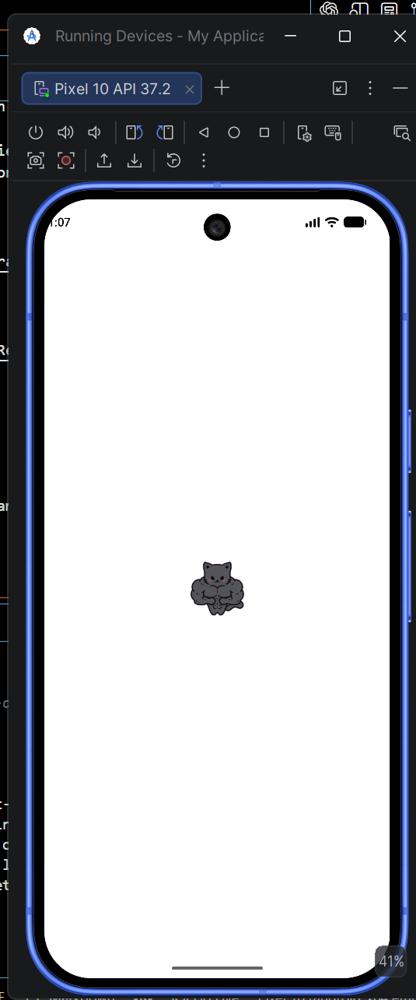</td>
    <td align="center">Discover y reproducción<br>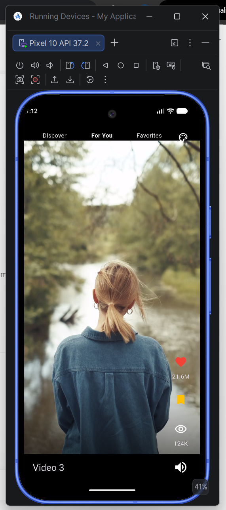</td>
    <td align="center">For You y Favorites<br>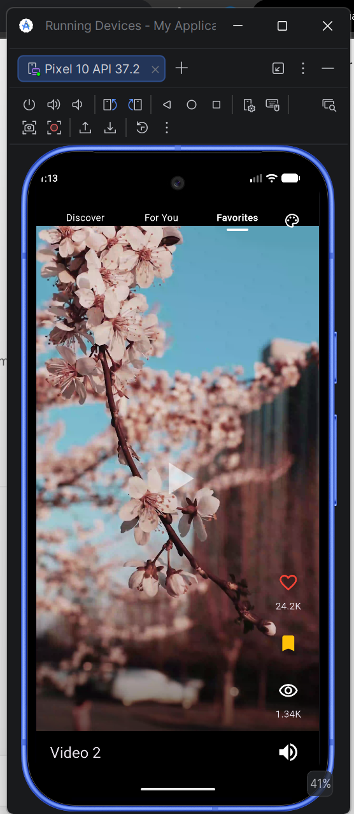</td>
    <td align="center">Likes<br>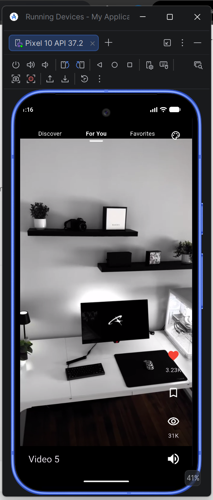</td>
  </tr>
  <tr>
    <td align="center">Muteo<br>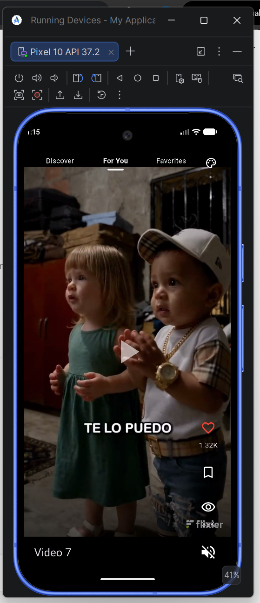</td>
    <td align="center">Descripción expandida<br>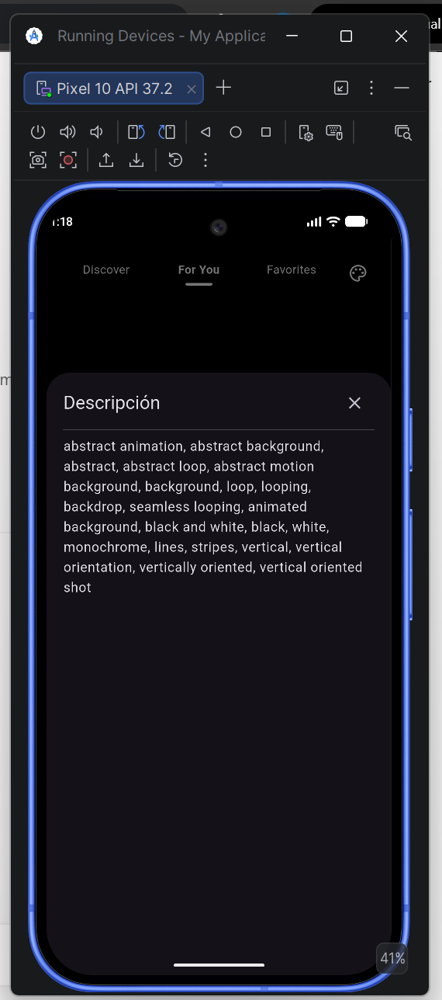</td>
  </tr>
</table>

### Temas estacionales

<table>
  <tr>
    <td align="center">Normal<br>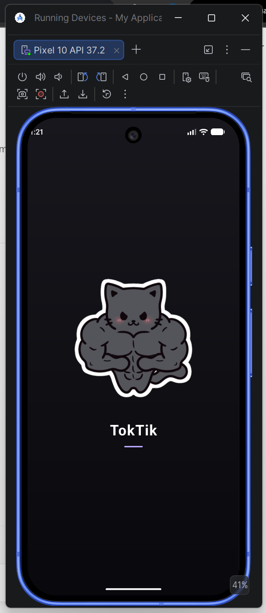</td>
    <td align="center">Halloween<br>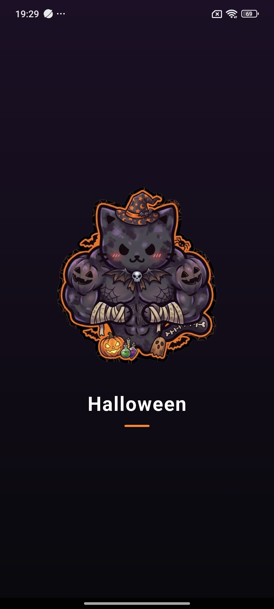</td>
    <td align="center">Christmas<br>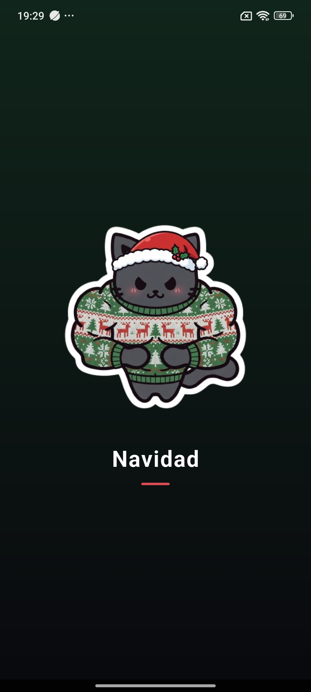</td>
    <td align="center">Valentine's Day y selector manual<br>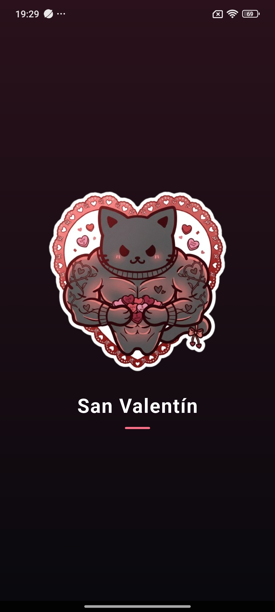</td>
  </tr>
</table>

<!-- Pendiente: agregar docs/evidencias/06-tema-normal.png -->
<!-- Pendiente: agregar docs/evidencias/07-tema-halloween.png -->
<!-- Pendiente: agregar docs/evidencias/08-tema-christmas.png -->
<!-- Pendiente: agregar docs/evidencias/09-tema-valentines-selector.png -->

### Pruebas en Appetize

<table>
  <tr>
    <td align="center">Primera configuración de dispositivo virtual<br>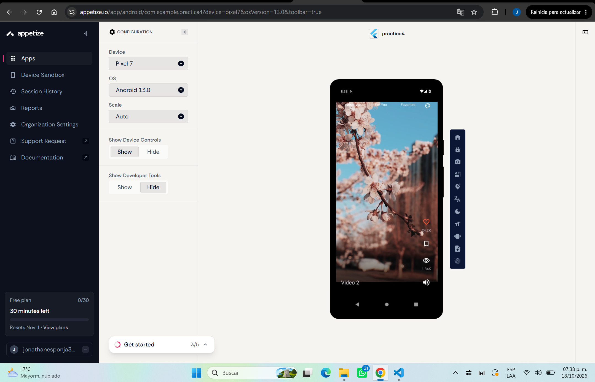</td>
    <td align="center">Segunda configuración de dispositivo virtual<br>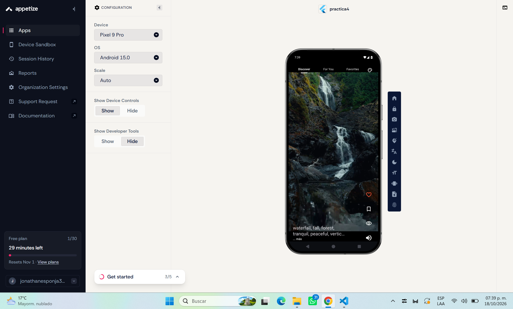</td>
    <td align="center">Panel de publicación o enlace real<br>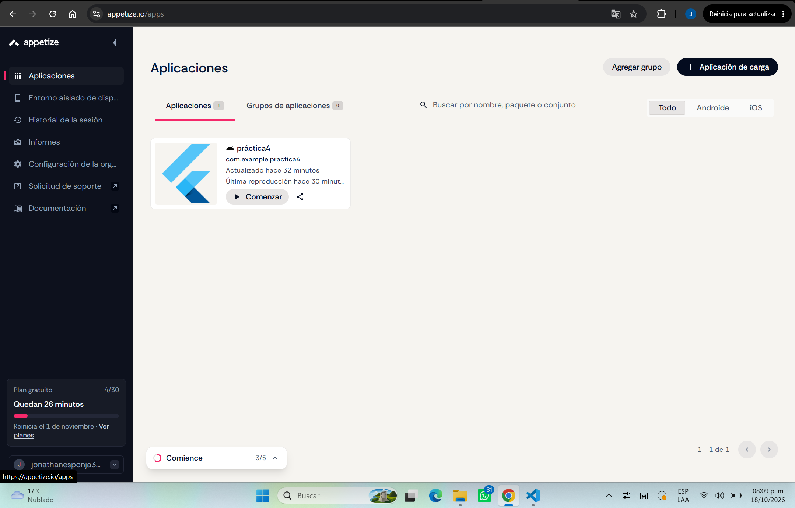</td>
  </tr>
</table>

<!-- Pendiente: agregar docs/evidencias/10-appetize-configuracion-1.png -->
<!-- Pendiente: agregar docs/evidencias/11-appetize-configuracion-2.png -->
<!-- Pendiente: agregar docs/evidencias/12-panel-publicacion-appetize.png -->

### Validación y GitHub

<table>
  <tr>
    <td align="center">Resultados de <code>flutter analyze</code> y <code>flutter test</code><br>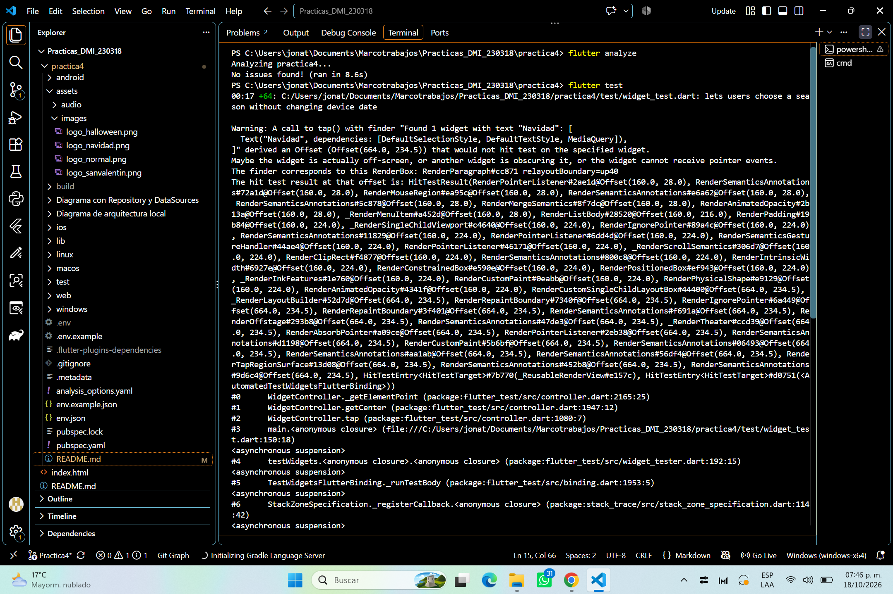</td>
  </tr>
</table>

<!-- Pendiente: agregar docs/evidencias/13-resultados-pruebas.png -->
<!-- Pendiente: agregar docs/evidencias/14-integracion-rama.png -->

## 7. Conclusión

TokTik integra feeds de video, persistencia de preferencias, temas estacionales
y varias fuentes conectadas mediante Provider y un repositorio. Permanecen por
comprobar la publicación y las dos configuraciones en Appetize, así como la
reproducción real de todos los videos en los dispositivos de destino. El enlace
de Appetize y las evidencias visuales se completarán cuando estén disponibles.
